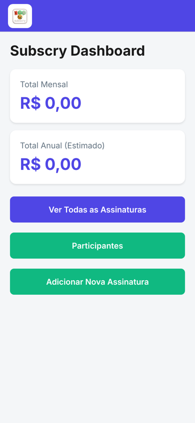
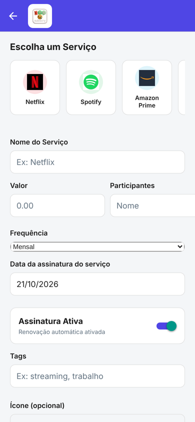

# Subscry

   

App mobile para controlar assinaturas (streaming, nuvem, apps) e **dividir o custo entre as pessoas que usam cada uma**, sem perder centavo na conta.

Nasceu de um problema real: dividir Netflix, Spotify e companhia com família e amigos e nunca saber quem deve quanto, nem quando cada uma renova. Fiz como projeto da faculdade (ADS, FATEC Praia Grande).

<p align="center">
  
  &nbsp;&nbsp;
  
</p>

## O que o app faz

- Cadastra, edita e remove assinaturas, com presets dos serviços mais comuns (Netflix, Spotify, Prime, Google One…)
- Calcula o **próximo vencimento** de cada assinatura a partir da data de início e da frequência
- Mostra no dashboard o total mensal e a estimativa anual
- Divide o valor entre participantes e soma **quanto cada pessoa deve** no total
- Exporta e importa os dados em JSON (backup simples, sem servidor)

## Decisões técnicas que valem explicar

**Dinheiro em centavos, nunca em float.** `0.1 + 0.2` em JavaScript dá `0.30000000000000004`. Todo valor é guardado como inteiro em centavos, e a formatação para R$ só acontece na tela.

**Divisão sem perder centavo.** R$ 10,00 dividido por 3 não fecha em 3,33 × 3. O algoritmo dá a cada pessoa a parte base (`floor(total / n)`) e distribui o resto, um centavo por vez, seguindo a ordem alfabética dos nomes. A soma das partes sempre bate exatamente com o total, e a divisão sai igual toda vez que você abre o app.

```ts
const base = Math.floor(totalCents / recipients.length);
let remainder = totalCents - base * recipients.length;
// ordena por nome; cada um recebe `base`, e os primeiros recebem +1 até o resto zerar
```

**Migração de dados idempotente.** Na primeira versão, os participantes ficavam embutidos dentro de cada assinatura. Quando passei a tratá-los como entidade própria (para somar o que cada pessoa deve), escrevi uma migração que roda na inicialização e pode rodar quantas vezes for preciso sem duplicar ninguém. Os nomes são normalizados (`trim` + `lowercase`) para "Ana" e "ana " virarem a mesma pessoa.

**Cálculo de vencimento testado.** A regra de "próxima data de cobrança" tem casos chatos (data de início no futuro, data de término, frequências diferentes). Por isso ela é uma função pura em `src/utils/dateUtils.ts`, coberta por testes com Jest.

## O que aprendi

- Modelar dinheiro de verdade: inteiros, arredondamento e distribuição de resto
- Evoluir o formato dos dados de um app que já tem dados salvos, sem quebrar o que existia
- Separar regra de negócio (utils/db) da interface (screens) para conseguir testar sem renderizar tela
- Navegação em stack, contexto de tema e formulários mais complexos em React Native

## Estrutura

```
App.tsx                  inicialização, migrações e navegação
src/
  screens/               Dashboard, lista, formulário, participantes, configurações
  db/                    persistência local (assinaturas e participantes)
  utils/dateUtils.ts     cálculo de vencimentos (função pura, testada)
  data/                  presets de serviços e ícones
__tests__/               testes com Jest
```

## Rodando

```bash
npm install --legacy-peer-deps
npx expo start        # abra no Expo Go (Android/iOS)
npm test              # testes
```

> A persistência usa o sistema de arquivos do dispositivo (`expo-file-system`). No navegador a interface abre, mas os dados não são salvos: o alvo do app é Android/iOS.

## Próximos passos

- Lembrete por notificação alguns dias antes do vencimento
- Expor as frequências semanal e personalizada no formulário (a lógica já existe)
- Histórico de pagamentos por participante

---

Feito por **Lucas Leite Gonzales** · [LinkedIn](https://www.linkedin.com/in/lucas-leite-gonzales-dev/)
